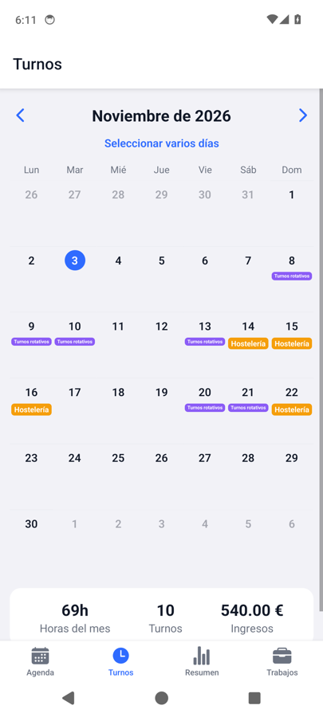
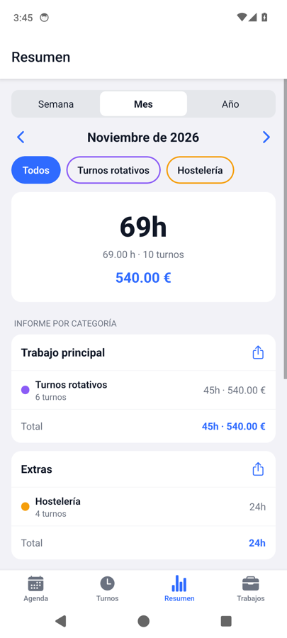
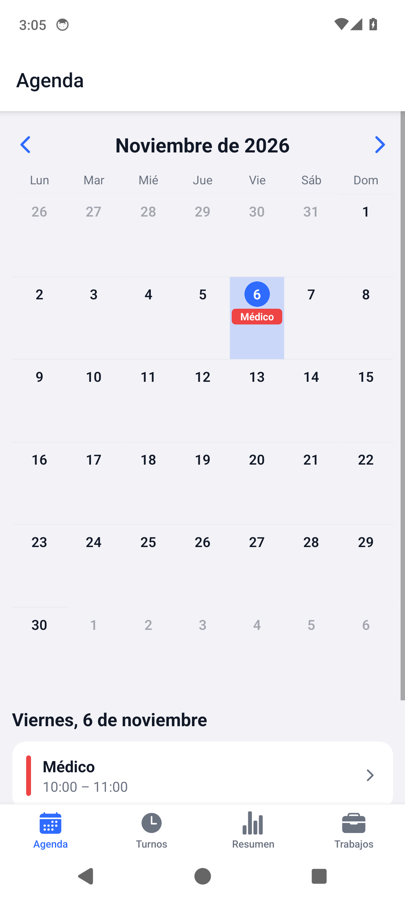
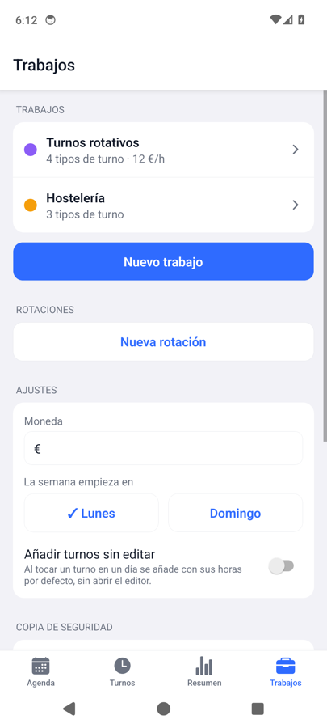
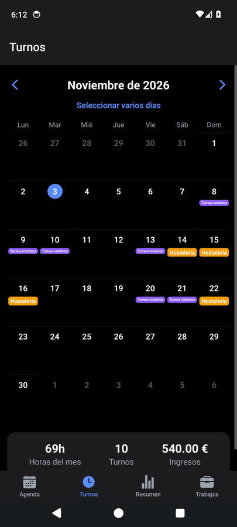
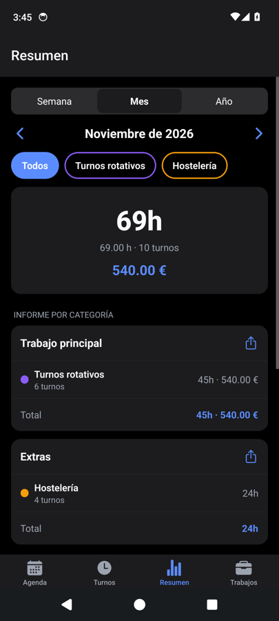
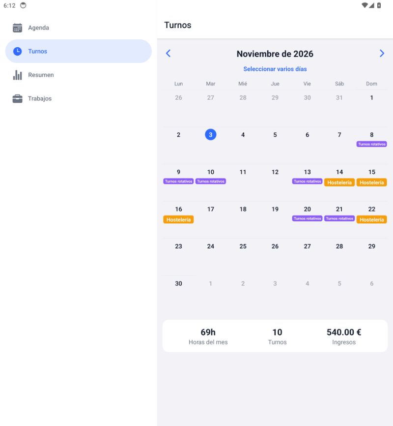
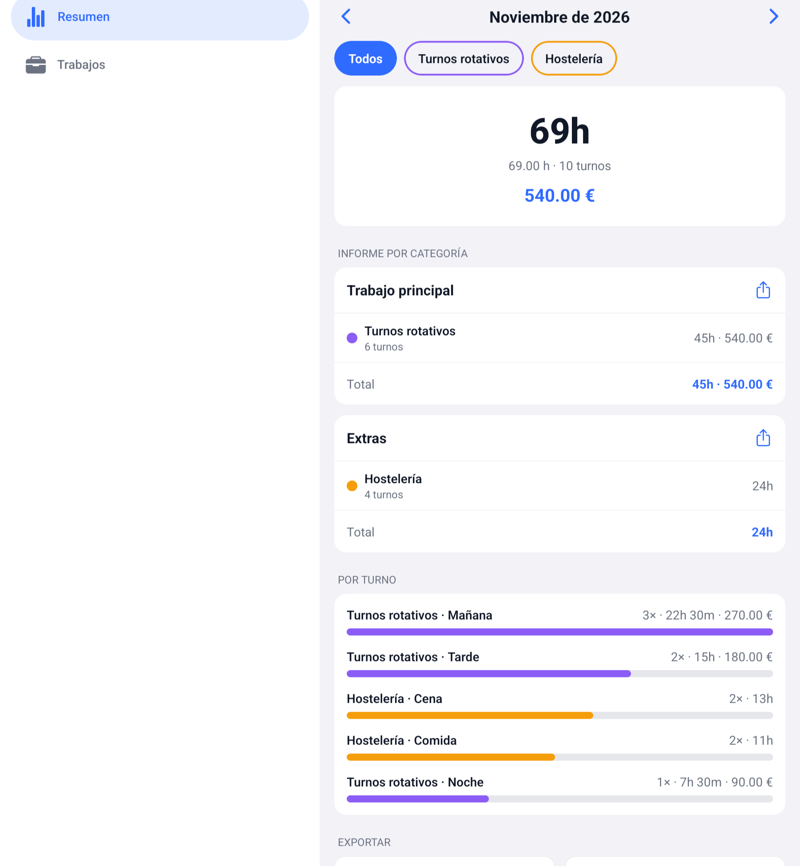
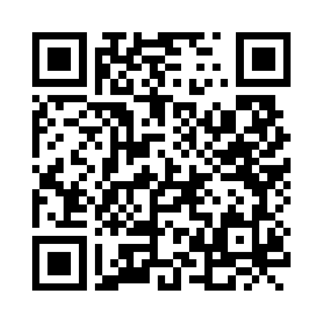

  

<h1 align="center">ShiftLog</h1>

  <b>Tu agenda y tus turnos de trabajo en una sola app para Android.</b> 
  Apunta qué trabajas cada día y calcula las horas, las horas extra y los ingresos.

  

  
  
  
  

  
  
  
  

## Por qué ShiftLog

- **Todo gratis y desbloqueado.** Sin anuncios, sin suscripciones y sin cuentas. Código abierto bajo licencia MIT.
- **Tus datos son tuyos.** Se guardan en tu dispositivo. Con internet solo hace dos cosas, ambas opcionales: avisarte de versiones nuevas y, si conectas tu cuenta de Google, guardar una copia en una carpeta oculta de tu propio Drive. Más detalles en la [política de privacidad](PRIVACY.md).
- **Pensada para turnos reales.** Varios trabajos, turnos que puedes ajustar cada día, horas extra, rotaciones y cobro por horas o por trabajo.

[Instalar](#instalar-la-app) · [Qué hace](#qué-hace) · [Apoya el proyecto](#apoya-el-proyecto)

## Qué hace

La app tiene dos partes separadas:

- **Agenda** – citas, recordatorios y cumpleaños. Nunca cuentan en las horas, el resumen ni las exportaciones.
- **Turnos, Resumen y Trabajos** – lo que sí cuenta como horas trabajadas.

### Trabajos y turnos
- Varios **trabajos** (empleos o clientes), cada uno con nombre, color y forma de cobro: **por horas** (tarifa por hora y reglas de horas extra) o **por trabajo** (un precio fijo cada vez que lo añades al calendario).
- Cada trabajo tiene sus **tipos de turno** (por ejemplo Mañana, Tarde, Noche): son plantillas con horario y un descanso opcional.
- Los turnos son orientativos: al añadirlos a un día se pueden **ajustar las horas** solo para ese día, o usar «Otro horario» para escribir las tuyas.
- Se pueden poner **varios turnos el mismo día**, también del mismo trabajo.
- **Plantillas de trabajo** (integradas y las tuyas) para crear un trabajo sin volver a escribirlo.
- **Rotaciones** (por ejemplo 4 días de trabajo y 2 libres) que se repiten sobre un rango de fechas.
- **Edición múltiple** de días en el calendario.

### Horas y resumen
- Resumen por semana, mes o año, con desglose por trabajo y por turno.
- **Horas extra** por trabajo (límite diario y semanal, con multiplicador de pago).
- Exportación a **PDF** (informe por días) y **CSV**.

### Agenda
- Eventos de todo el día o con horas (se pueden tomar las horas de uno de tus turnos).
- Plantillas de evento, también integradas y propias.

### Copia de seguridad y actualizaciones
- **Copia en Google Drive** (opcional): al conectar tu cuenta, los datos se guardan solos en una carpeta oculta de tu Drive y se pueden restaurar en otro móvil. Nunca se sobrescribe una copia de otra instalación sin preguntarte.
- **Avisos de versiones nuevas**: la app consulta GitHub, muestra las novedades y descarga e instala la actualización desde dentro.

### Diseño

  
  

En tablet y pantallas anchas aparece una barra lateral y el calendario se muestra más grande:

  
  

- Modo claro y oscuro, adaptado a móvil y tablet (en pantallas anchas, barra lateral y calendario con el día a un lado).
- Horas y fechas con teclado numérico (los dos puntos y los guiones se añaden solos) o con el selector nativo de Android.

## Instalar la app

<table>
<tr>
<td width="200" align="center">
   
  Escanéalo con el móvil
</td>
<td>

1. Descarga el APK desde [Releases](https://github.com/Camach0F/ShiftLog/releases/latest) en tu móvil o tablet Android. Enlace directo: [`ShiftLog.apk`](https://github.com/Camach0F/ShiftLog/releases/latest/download/ShiftLog.apk) (siempre la última versión).
2. Ábrelo y, si Android lo pide, permite «instalar apps de orígenes desconocidos» para el navegador o el gestor de archivos que uses.
3. Para actualizar, la propia app avisa cuando hay una versión nueva y la descarga e instala desde **Ajustes → Actualizaciones** (Android te pide confirmar). Se conservan tus datos.

</td>
</tr>
</table>

Los APK los compila y firma GitHub Actions a partir de este código, así que el archivo de Releases es el que sale del repositorio. Requiere Android 7 o superior.

### Con Obtainium
[Obtainium](https://github.com/ImranR98/Obtainium) instala y actualiza apps directamente desde GitHub: pulsa **Añadir app**, pega `https://github.com/Camach0F/ShiftLog` y listo. Recibirás los avisos de versiones nuevas desde ahí.

### Compartirla
Dentro de la app, en **Ajustes → Compartir**, hay un botón que envía el enlace de descarga por WhatsApp, Telegram, correo o lo que prefieras.

## Apoya el proyecto

ShiftLog es gratuita y de código abierto, y siempre lo será. Si te resulta útil y quieres ayudar a seguir mejorándola, puedes hacer una donación voluntaria, de una sola vez y con el importe que quieras, con GitHub Sponsors o con PayPal:

Donar no desbloquea nada: la app es igual para todos. Gracias por el apoyo.

## Licencia

Código abierto bajo la licencia [MIT](LICENSE). Puedes usarlo, modificarlo y distribuirlo libremente manteniendo el aviso de copyright.

Es un proyecto independiente: no está afiliado a ninguna otra app de turnos ni reutiliza su nombre, textos o diseño.
